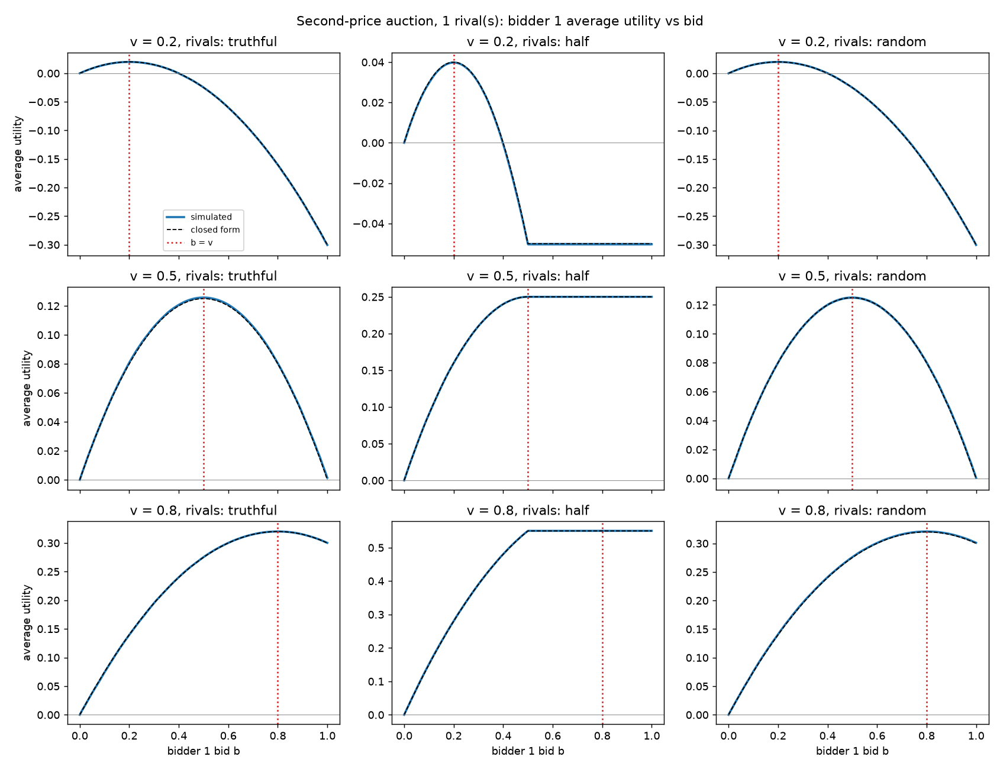
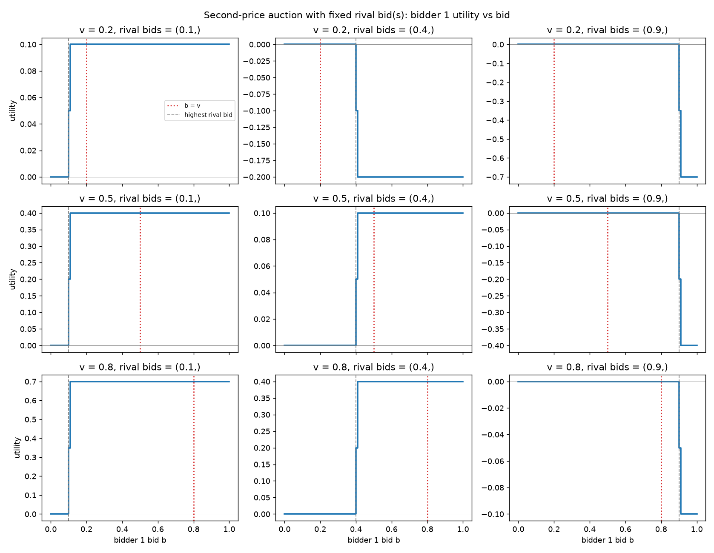
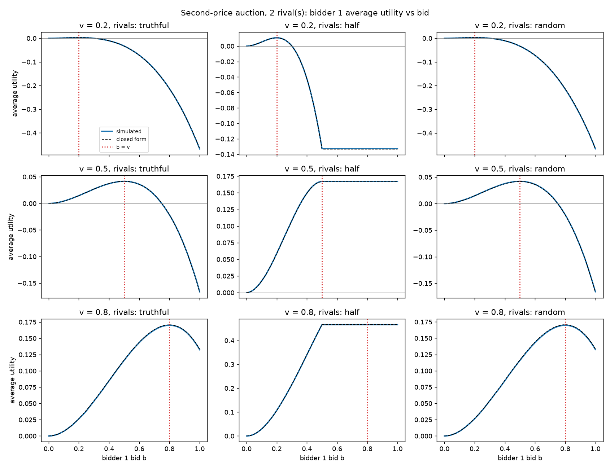
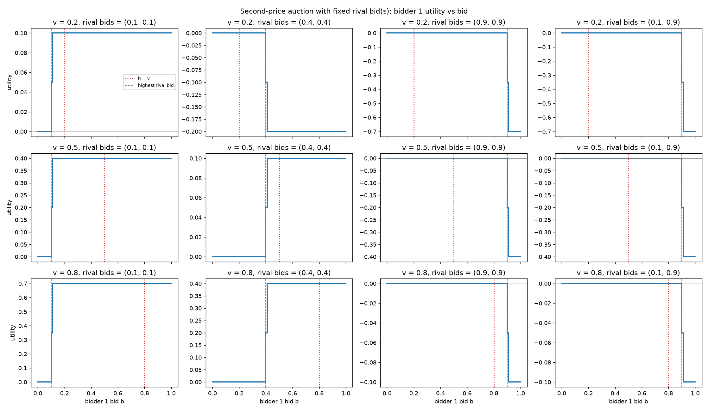
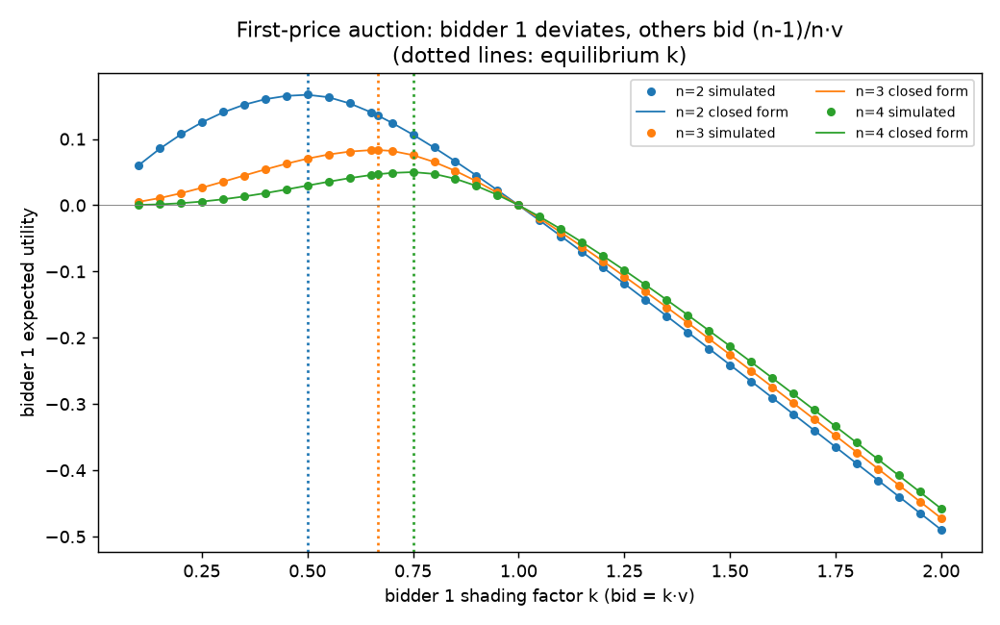
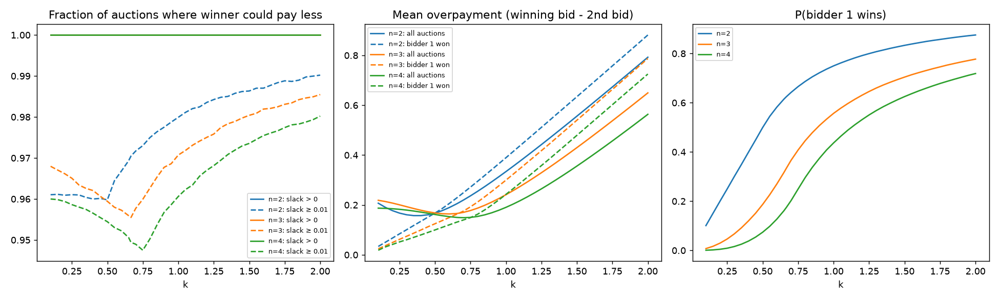
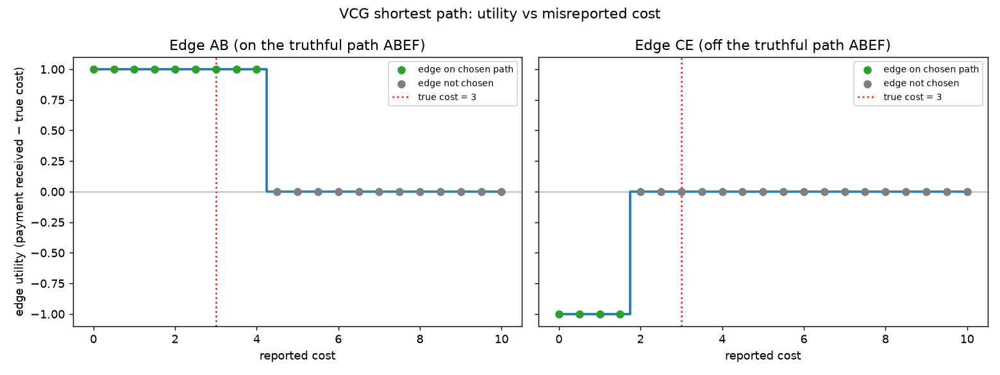

# Auctions and VCG: Simulation Report

Reference: Shoham & Leyton-Brown, *Multiagent Systems*, Chapter 7: Thm 7.9 (second-price auction is truthful), Thm 7.10 (first-price equilibrium bid (n−1)/n·v), §4.2 and Fig 7.3 (VCG shortest path).

## How to run

```bash
python3 -m venv .venv && .venv/bin/pip install -r requirements.txt
.venv/bin/python part1_spa.py    # ~3 s
.venv/bin/python part2_fpa.py    # ~1 s
.venv/bin/python part3_vcg.py    # instant
```

Each script prints its tables as markdown and saves plots to `figures/`. The random seeds are fixed, so results are reproducible. Each script checks its own results with assertions:
- the simulations must agree with closed-form expected utility within 5 standard errors;
- b = v must be optimal (Part 1);
- the VCG path and payments must match the book exactly (Part 3);
- no misreport may beat truth-telling (Part 3).

Every assertion passes.

**Modelling choices**
- Bid grid is `np.arange(101)/100`, so a bid of 0.40 equals a rival bid of 0.4 exactly. A tie is split 50/50 (half the win utility). Ties only occur in the fixed-rival-bid experiments.
- Part 1 uses common random numbers: one set of 100,000 rival draws is reused for every bid. Each bid still gets 100,000 auctions, and the curves are smoother.
- Part 2: bidder 1's value is random (v₁ ~ U[0,1]), so the reported utility is the ex-ante expectation. The k grid is 0.10–2.00 in steps of 0.05, plus 2/3 so every equilibrium k is on the grid. Each k gets 200,000 auctions.
- Part 3: when two paths cost the same, the lexicographically smallest path wins.

---

## Part 1: Second-price sealed-bid auction

Bidder 1's expected utility with m rivals whose bids are i.i.d. U[0,c] is

E[u(b)] = v·tᵐ − m·c·tᵐ⁺¹/(m+1),  where t = min(b,c)/c.

The dashed line in each plot is this formula.

### 1A: one rival (9 plots)



| v | rival strategy | best bid (sim) | u(b=v) | max u |
|---|---|---|---|---|
| 0.2 | truthful | 0.20 | 0.0199 | 0.0199 |
| 0.2 | half | 0.20 | 0.0398 | 0.0398 |
| 0.2 | random | 0.20 | 0.0200 | 0.0200 |
| 0.5 | truthful | 0.50 | 0.1257 | 0.1257 |
| 0.5 | half | 0.50 | 0.2500 | 0.2500 |
| 0.5 | random | 0.50 | 0.1251 | 0.1251 |
| 0.8 | truthful | 0.80 | 0.3201 | 0.3201 |
| 0.8 | half | plateau [0.50, 1.00] | 0.5503 | 0.5503 |
| 0.8 | random | 0.80 | 0.3209 | 0.3209 |

**Do these plots help bidder 1 choose a strategy? Yes.**
- In all 9 cases the curve peaks at b = v. The best bid therefore does not depend on which strategy the rival uses, so bidder 1 does not need to know or guess it. This is truthful bidding as a dominant strategy (Thm 7.9).
- Bidding below v gives up auctions that would have been profitable. Bidding above v adds only auctions where the price is above v, which lose money.
- The *truthful* and *random* rivals give the same curve. In both cases the rival's bid is distributed U[0,1], and bidder 1 only ever sees the bid.
- Against the *half* rival, rival bids never go above 0.5. Any bid ≥ 0.5 wins every auction at the same price, which produces a plateau. For v = 0.8, b = v is on the plateau: it is optimal, though not the only optimal bid. This is *weak* dominance.
- With v = 0.2, overbidding is costly: u(1.0) = −0.30 against a truthful or random rival.

### 1B: fixed rival bid r ∈ {0.1, 0.4, 0.9}



| v | r | u(b=v) | max u | set of optimal bids |
|---|---|---|---|---|
| 0.2 | 0.1 | 0.10 | 0.10 | [0.11, 1.00] |
| 0.2 | 0.4 | 0.00 | 0.00 | [0.00, 0.39] |
| 0.2 | 0.9 | 0.00 | 0.00 | [0.00, 0.89] |
| 0.5 | 0.1 | 0.40 | 0.40 | [0.11, 1.00] |
| 0.5 | 0.4 | 0.10 | 0.10 | [0.41, 1.00] |
| 0.5 | 0.9 | 0.00 | 0.00 | [0.00, 0.89] |
| 0.8 | 0.1 | 0.70 | 0.70 | [0.11, 1.00] |
| 0.8 | 0.4 | 0.40 | 0.40 | [0.41, 1.00] |
| 0.8 | 0.9 | 0.00 | 0.00 | [0.00, 0.89] |

**Confirmed: b = v achieves the highest utility in all 9 cases.**

Utility is a step function: 0 for b < r, and v − r for b > r. Every bid on the same side of r as v is equally good, and b = v always lies on the correct side:
- If v > r, bidder 1 wins and earns v − r.
- If v < r, bidder 1 loses and avoids the negative utility v − r.

Bidding on the wrong side of r is never better and is sometimes strictly worse. For example, with v = 0.2 and r = 0.4, any bid above 0.4 gives −0.2.

### 1C: two rivals using the same strategy

**Random rival values (1A repeated)**



| v | rival strategy | best bid (sim) | u(b=v) | max u |
|---|---|---|---|---|
| 0.2 | truthful | 0.20 | 0.0027 | 0.0027 |
| 0.2 | half | 0.20 | 0.0108 | 0.0108 |
| 0.2 | random | 0.20 | 0.0027 | 0.0027 |
| 0.5 | truthful | 0.50 | 0.0416 | 0.0416 |
| 0.5 | half | 0.50 | 0.1670 | 0.1670 |
| 0.5 | random | 0.50 | 0.0420 | 0.0420 |
| 0.8 | truthful | 0.80 | 0.1701 | 0.1701 |
| 0.8 | half | plateau [0.50, 1.00] | 0.4664 | 0.4664 |
| 0.8 | random | 0.80 | 0.1699 | 0.1699 |

With uniform rivals, the closed form is E[u] = v·b² − 2b³/3. Its derivative, 2b(v − b), is zero at b = v.

A second rival lowers utility at every bid, because bidder 1 wins less often and pays a higher price (the maximum of two rival bids). The best bid is still exactly b = v in every case. Adding competitors does not change bidder 1's optimal strategy.

**Fixed rival bids (1B repeated)**



Both rivals were fixed at the same r ∈ {0.1, 0.4, 0.9}, plus one mixed pair (0.1, 0.9). In all 12 cases b = v is optimal. Only the highest rival bid matters, so the results for (r, r) are identical to the one-rival case with bid r, and the mixed pair (0.1, 0.9) behaves exactly like a single rival bidding 0.9.

---

## Part 2: First-price auction, n bidders

Bidders 2…n bid (n−1)/n·v. Bidder 1 bids k·v₁. Given v₁, bidder 1 wins with probability min(1, n·k·v₁/(n−1))ⁿ⁻¹, so

E[u | v₁] = v₁(1−k)·min(1, n·k·v₁/(n−1))ⁿ⁻¹.

This is integrated numerically over v₁ ~ U[0,1] to give the solid lines in the plot.



| n | equilibrium k = (n−1)/n | best k (sim) | E[u] at best k | theory 1/(n(n+1)) | E[u] at k=1 | E[u] at k=2 |
|---|---|---|---|---|---|---|
| 2 | 0.500 | 0.50 | 0.1668 | 0.1667 | 0.0000 | −0.4902 |
| 3 | 0.667 | 0.67 | 0.0835 | 0.0833 | 0.0000 | −0.4728 |
| 4 | 0.750 | 0.75 | 0.0499 | 0.0500 | 0.0000 | −0.4574 |

- For each n, bidder 1's expected utility peaks at k = (n−1)/n, which confirms Thm 7.10. Deviating in either direction lowers utility, so no profitable unilateral deviation exists.
- Shading less (k → 1) wins more often but leaves no profit margin. At k = 1, utility is exactly 0.
- Overbidding (k > 1) wins auctions at a price above value, so utility is negative and roughly linear in k.
- As n grows, the equilibrium bid moves toward truthful bidding (k → 1) and the payoff falls as 1/(n(n+1)), because competition squeezes the margin.

### Could the winner have paid less and still won?

For each auction, *slack* = winning bid − second-highest bid. Any slack > 0 means the winner could have bid less and still won.



| n | k | P(bidder 1 wins) | frac. slack > 0 | frac. slack ≥ 0.01 | mean slack (all) | mean slack (bidder 1 won) |
|---|---|---|---|---|---|---|
| 2 | 0.50 (eq.) | 0.500 | **1.0000** | 0.960 | 0.167 | 0.167 |
| 2 | 1.00 | 0.750 | 1.0000 | 0.980 | 0.334 | 0.390 |
| 2 | 1.50 | 0.833 | 1.0000 | 0.986 | 0.556 | 0.634 |
| 3 | 0.67 (eq.) | 0.334 | **1.0000** | 0.956 | 0.167 | 0.166 |
| 3 | 1.00 | 0.557 | 1.0000 | 0.971 | 0.241 | 0.300 |
| 3 | 1.50 | 0.704 | 1.0000 | 0.980 | 0.430 | 0.540 |
| 4 | 0.75 (eq.) | 0.250 | **1.0000** | 0.948 | 0.150 | 0.149 |
| 4 | 1.00 | 0.437 | 1.0000 | 0.961 | 0.190 | 0.242 |
| 4 | 1.50 | 0.625 | 1.0000 | 0.974 | 0.356 | 0.479 |

(Rows with k = 0.67 are run at exactly k = 2/3.)

- **The fraction is 100% for every n and k.** Values are continuous, so two bids are never exactly equal, and the first-price winner always pays its own bid, which is strictly above the second-highest bid. In a first-price auction the winner always leaves money on the table. A second-price auction removes this by charging the second-highest bid.
- Counting only overpayments of at least 1 cent, the fraction is still about 95–99%.
- At equilibrium the mean overpayment is about 0.17 (n=2), 0.17 (n=3) and 0.15 (n=4). It shrinks as competition increases, because bids are packed more closely together.
- Overbidding (k > 1) makes bidder 1 win more often, but it then overpays by a large and growing amount, which is why its expected utility turns negative.

---

## Part 3: VCG for the cheapest path (Fig 7.3)

The edge costs below are read from Fig 7.3 of the book. Edges are directed.

| AB | AC | BD | BE | CE | CF | DF | EF |
|---|---|---|---|---|---|---|---|
| 3 | 2 | 2 | 1 | 3 | 5 | 2 | 1 |

There are four A→F paths: ABDF (7), **ABEF (5)**, ACEF (6) and ACF (7).

Edge i's payment in the book's sign convention, where a negative payment means the mechanism pays the edge:

p_i = (cost to the other edges on the chosen path) − (cost of the best path without i)

### Reproducing the book

| edge | true cost | on path | best path without edge | p_i | mechanism pays edge | utility |
|---|---|---|---|---|---|---|
| AB | 3 | yes | ACEF (6) | −4 | **4** | 1 |
| AC | 2 | no | ABEF (5) | 0 | 0 | 0 |
| BD | 2 | no | ABEF (5) | 0 | 0 | 0 |
| BE | 1 | yes | ACEF (6) | −2 | **2** | 1 |
| CE | 3 | no | ABEF (5) | 0 | 0 | 0 |
| CF | 5 | no | ABEF (5) | 0 | 0 | 0 |
| DF | 2 | no | ABEF (5) | 0 | 0 | 0 |
| EF | 1 | yes | ABDF (7) | −3 | **3** | 2 |

The chosen path is ABEF, and AB, BE and EF are paid 4, 2 and 3; every other edge is paid 0. This matches the book exactly. EF and BE have the same cost, but EF is paid more because removing EF hurts the other edges more (7 vs 6). EF has more market power.

### Misreporting: reported cost from 0 to 10 in steps of 0.5



**On-path edge AB (true cost 3, truthful utility 1)**
- Any report r ≤ 4 keeps AB on the path. AB's payment is set by the alternatives (6 − 2 = 4), not by its own report, so utility stays at 1 and the change is 0.
- At r = 4 the paths ABEF and ACEF tie at 6. The tie-break keeps AB on the path, so utility is still 1.
- Any report r ≥ 4.5 pushes AB off the path (ACEF is chosen). Utility drops to 0, a change of −1.

**Off-path edge CE (true cost 3, truthful utility 0)**
- Any report r ≥ 2 leaves CE off the path, so utility stays at 0.
- Any report r < 2 puts CE on the path (ACEF costs r + 3 < 5). CE is then paid only 5 − 3 = 2, which is less than its true cost of 3. Utility is −1.

**All 8 edges swept:** no edge can raise its utility by misreporting.

| edge | truthful utility | best misreport | worst misreport |
|---|---|---|---|
| AB | 1 | 1 | 0 |
| AC | 0 | 0 | −1 |
| BD | 0 | 0 | −2 |
| BE | 1 | 1 | 0 |
| CE | 0 | 0 | −1 |
| CF | 0 | 0 | −2 |
| DF | 0 | 0 | −2 |
| EF | 2 | 2 | 0 |

**Conclusion.** An edge's report affects only *whether* its edge is chosen, never how much it is paid when chosen. Lying either changes nothing or causes the wrong decision, in two ways:
- An edge that overstates its cost can lose a profitable slot.
- An edge that understates its cost can win a slot paying less than its true cost.

This is dominant-strategy truthfulness of VCG (Groves) in practice.

Note also that VCG paid out 4 + 2 + 3 = 9 for a path that actually costs 5. The mechanism runs a deficit: it is not budget balanced, as discussed in §4.3.2.
